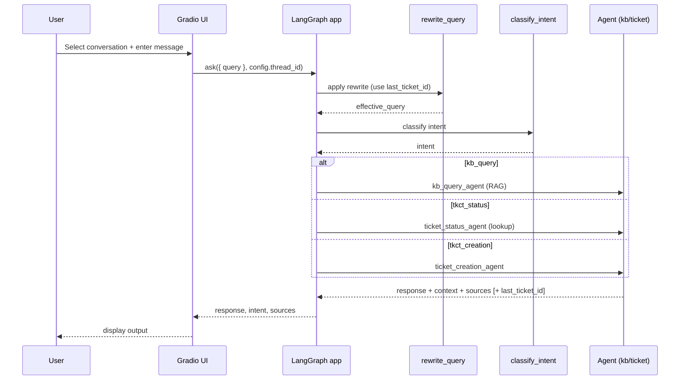

# Smart Desk AI — Architecture

This document describes the project layout and how a request flows through the system. It includes visual diagrams (Mermaid) for a quick mental model.

## Folder structure (key paths)

```text
SmartDesk-AI/
├─ project/
│  ├─ agents/
│  │  ├─ kb_agent.py                # HR/IT RAG agent
│  │  ├─ ticket_creation_agent.py   # Escalation/creation agent
│  │  └─ ticket_status_agent.py     # Ticket lookup agent (synthetic dataset)
│  ├─ documents/
│  │  ├─ hr-policies.md             # HR KB sources (RAG)
│  │  ├─ it-support.md
│  │  ├─ onboarding.md
│  │  └─ payroll.md
│  ├─ ragSetup/
│  │  └─ rag_setup.py               # Build embeddings, Chroma vector store, retriever
│  ├─ tickets/
│  │  └─ synthetic_tickets.json     # Mock tickets dataset (reported as "tickets.db" source)
│  └─ smart_desk_ai_agent.py        # Builds LangGraph, routing, checkpointer, ask()
│
├─ run_project/
│  ├─ ui_smart_desk_ai_agent.py     # Gradio ChatInterface with thread selector
│  ├─ gui_smart_desk_ai_agent.py    # Alternate ChatInterface launcher
│  └─ test_smart_desk_ai_agent.py   # Scripted runs; supports (query, thread_id) tuples
├─ QuickStart.md                     # Setup and run instructions
└─ Architecture.md                   # This document
```

## Core components

- smart_desk_ai_agent.py
  - Builds the RAG pipeline (via ragSetup/rag_setup.py) and local TinyLlama GGUF chat model
  - Declares SupportState and assembles a LangGraph with nodes:
    - rewrite_query: resolves references like "that ticket" using last_ticket_id
    - classify_intent: routes to kb_query, tkct_status, or tkct_creation
    - kb_query_agent: answers HR/IT questions with RAG
    - ticket_status_agent: ticket status/lookup by ID or email
    - ticket_creation_agent: collects details and escalates
  - Enables per-thread memory with a checkpointer (MemorySaver by default; SqliteSaver optional)
  - Exposes ask(app, query, thread_id) which only sends the new query (state persists by thread)

- ragSetup/rag_setup.py
  - Loads markdown documents and chunks with RecursiveCharacterTextSplitter
  - Embeds locally with HuggingFaceEmbeddings (`sentence-transformers/all-MiniLM-L6-v2`) and stores in Chroma
  - Exposes a retriever (k configurable; supports MMR if enabled) and format_docs

- agents/
  - kb_agent.py: builds answer from retrieved context and appends to history
  - ticket_status_agent.py: loads synthetic_tickets.json, composes response; sets last_ticket_id and reports source as "tickets.db"
  - ticket_creation_agent.py: gathers details and returns handoff guidance

- UI & Tests
  - UI launchers use a Gradio ChatInterface with a conversation selector; each selection maps to an independent LangGraph thread and retains its transcript in the browser session
  - test_smart_desk_ai_agent.py: batch invocation; supports (query, thread_id) to demonstrate multi-conversation

## Execution flow (LangGraph)

```mermaid
flowchart LR
    A[START] --> B[rewrite_query\n- resolve "that ticket"\n- use last_ticket_id]
    B --> C[classify_intent\nkb_query | tkct_status | tkct_creation]
    C -->|kb_query| D[kb_query_agent\nRAG over documents]
    C -->|tkct_status| E[ticket_status_agent\nlookup by ID/email\nupdates last_ticket_id]
    C -->|tkct_creation| F[ticket_creation_agent\ncollect details]
    D --> G[END]
    E --> G
    F --> G

    subgraph Memory & Routing
      H[(checkpointer)] --- A
      I[thread_id] --> H
    end
```

## Request/response sequence



## Data flow

```mermaid
flowchart LR
    subgraph KB
      K1[documents/*.md] -->|split| K2[Text Splitter]
      K2 -->|embed| K3[HuggingFaceEmbeddings]
      K3 --> K4[Chroma Vector Store]
      K4 --> K5[Retriever (k, MMR optional)]
    end

    subgraph Tickets
      T1[synthetic_tickets.json] --> T2[ticket_status_agent]
      T2 -->|source| T3["tickets.db"]
    end

    Q[Query] --> RW[rewrite_query]
    RW --> CL[classify_intent]
    CL -->|kb_query| K5
    CL -->|tkct_status| T2
```

## SupportState shape

```python
# python
class SupportState(TypedDict):
    query: str
    intent: str
    response: str
    context: str
    retrieved_sources: list[str]
    history: list[dict[str, str]]               # [{"role":"user"|"assistant", "content": ...}]
    effective_query: str                        # rewritten query when needed
    last_ticket_id: str                         # e.g., "TICK-002"
```

## Notes
- Per-thread state is keyed by configurable.thread_id; MemorySaver persists in-process, SqliteSaver persists across runs.
- Ticket answers cite source as "tickets.db"; KB answers cite the actual markdown file.
- For KB questions like "Code of conduct", improve recall with higher k, reranking, or MMR in the retriever.
